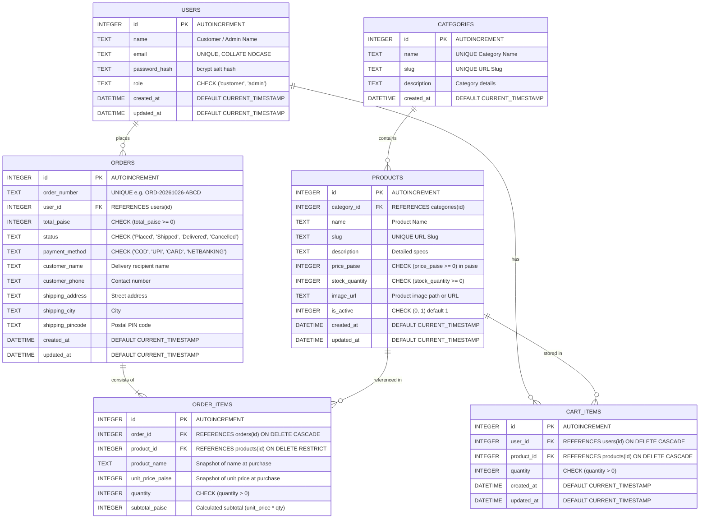

# ShopEasy Database Entity Relationship (ER) Diagram

ShopEasy uses a fully normalized SQLite relational database schema enforcing foreign key constraints (`PRAGMA foreign_keys = ON;`) and WAL (Write-Ahead Logging) mode.

---

## 1. Visual Entity Relationship (ER) Diagram

---

## 2. Key Architectural Decisions for Viva Defense

### A. Monetary Representation in Integer Paise
* **Why?** JavaScript and standard floating-point numbers suffer from IEEE 754 precision issues (e.g., `0.1 + 0.2 === 0.30000000000000004`).
* **Solution:** All prices are stored as positive integers in **paise** (1 Rupee = 100 paise).
  - Example: `₹1,999.00` is stored as `199900`.
  - Conversions are strictly isolated to helper utilities (`toPaise`, `toRupees`, `formatINR`).

### B. Historical Accuracy in `order_items`
* When an order is placed, `order_items` stores:
  - `unit_price_paise`: The exact price paid at the time of purchase.
  - `product_name`: The product name at the time of purchase.
* **Why?** If an administrator changes a product price or renames it in the future, past customer invoices and receipts remain 100% accurate.

### C. Foreign Key Constraints & Cascading Rules
* `cart_items`: Configured with `ON DELETE CASCADE` so deleting a user or product automatically cleans up orphaned cart entries.
* `orders` & `order_items`: Configured with `ON DELETE RESTRICT` for products, preventing accidental deletion of products that are tied to existing financial order histories.
